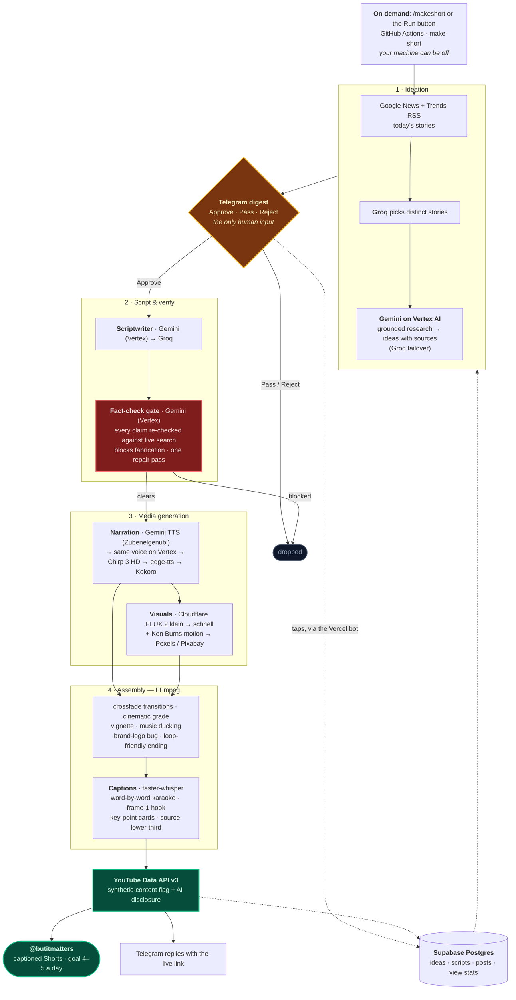

# 🎬 AI Reel Factory: **But It Matters**

**Channel:** *But It Matters*, daily impact news/info explainers (India + world).
**Live:** publishing captioned Shorts to **[@butitmatters](https://youtube.com/@butitmatters)**.

A near-zero-cost autonomous system that researches the news, writes scripts, fact-checks them,
narrates in a near-human voice, generates story-specific visuals, edits a polished captioned
vertical video, and publishes faceless Shorts. The human part happens in Telegram: start a run
with `/makeshort`, then approve the ideas worth making from the digest (up to 3 a run).

> **Primary goal:** Reliably publish **4–5 automated, captioned YouTube Shorts per day.**
> Consistency beats sophistication. Don't chase perfection early.

---

## 🧭 Start here

1. **[CLAUDE.md](CLAUDE.md)** — operating rules for any agent working in this repo. **Read first.**
2. **[STATUS.md](STATUS.md)** — live build state (what's done, what's next, blockers).
3. **[CHANGELOG.md](CHANGELOG.md)**; what shipped, version by version.
4. The docs, in order:

| # | Doc | What it's for |
|---|-----|---------------|
| 1 | [docs/01-design-spec.md](docs/01-design-spec.md) | Architecture & decisions (the "why") |
| 2 | [docs/02-implementation-plan.md](docs/02-implementation-plan.md) | Phase-1 MVP build, step by step |
| 3 | [docs/03-setup-guide.md](docs/03-setup-guide.md) | Accounts + API keys to create **before** coding |
| 4 | [docs/04-free-tools-reference.md](docs/04-free-tools-reference.md) | Every free tool, its limits, links |
| 5 | [docs/05-content-system.md](docs/05-content-system.md) | Templates + the hook database |
| 6 | [docs/06-roadmap.md](docs/06-roadmap.md) | The 5 phases from MVP to multi-niche scale |
| 7 | [docs/07-architecture-diagram.md](docs/07-architecture-diagram.md) | Visual system + data flow |
| 8 | [docs/08-news-niche-playbook.md](docs/08-news-niche-playbook.md) | **Niche compliance: non-negotiable** |

---

## ⚡ TL;DR: the stack

| Layer | Tool | Cost |
|-------|------|------|
| Trigger | `/makeshort` in the Telegram bot (a Vercel function) or the `make-short` workflow's Run button; on demand only | Free |
| Orchestration | GitHub Actions (`make-short`, `ubuntu-24.04`, Python 3.12) | Free |
| **Ideation** | Google News + Google Trends RSS → **Groq** picks distinct stories → **Gemini on Vertex AI** researches them with grounded search → ideas with ≥ 2 source links. A Claude Routine (`routines/ideation.md`) is optional and dormant | Vertex: per token |
| Database/state | Supabase Postgres | Free |
| Approval UI | Telegram digest: ✅ Approve / ⏭️ Pass / ❌ Reject (up to 3 a run) | Free |
| Scripts | `gemini-3.8-flash` on Vertex (grounded write on `gemini-3.5-flash-lite` → `3.5-flash`); Groq `openai/gpt-oss-120b` failover | Vertex: per token |
| **Fact-check gate** | `gemini-3.5-flash` → `3.5-flash-lite` on Vertex, grounded: 2 samples, blocks fabrication, one repair pass | Vertex: per token |
| **Narration** | **Gemini TTS** `gemini-3.1-flash-tts-preview`, Zubenelgenubi (Developer API, then the same voice on Vertex) → Chirp 3 HD → edge-tts (en-IN) → Kokoro | Developer API free; Vertex + Chirp billed |
| **Visuals** | **AI B-roll: Cloudflare Workers AI FLUX.2 klein → FLUX.1 schnell + Ken Burns** → Pexels photos → Pexels/Pixabay stock video | Free |
| **Video edit** | FFmpeg: crossfade transitions · cinematic grade · vignette · **music ducking** · **brand-logo bug** · loop-friendly endings · -14 LUFS | Free |
| Captions | faster-whisper word timings on the script's own text: karaoke (3-word groups) + frame-1 hook + key-point cards + **source lower-third** | Free |
| Publishing | YouTube Data API v3 (synthetic-content flag + disclosure) | Free |

**Cost target:** **≤ $5/month** beyond the existing Claude Pro subscription. The billed parts are
Vertex AI (Gemini text, grounding, the fact-check gate, the same-voice TTS fallback) and Cloud
Text-to-Speech (Chirp), both on Google Cloud project `but-it-matters-tts`, watched by a
₹450/month budget with 50/90/100% alerts. Spend so far fits the cap; everything else runs on
free tiers.

---

## ✅ Current status: **Phase-1 MVP complete & publishing live**

See [STATUS.md](STATUS.md) for live detail; latest release notes in [CHANGELOG.md](CHANGELOG.md).

- [x] Full pipeline **built, tested, and publishing** captioned Shorts to **@butitmatters** (about 81 public as of 2026-10-09)
- [x] Every module done + tested in isolation; CI **740 pass, 5 skipped** on 2026-10-22 (the skips are opt-in live tests): config · db · llm · news · trends · ideation · approval · scriptwriter · factcheck · voice · visuals · assembly · subtitles · publish · analytics · orchestrator · bot
- [x] All credentials collected & verified (Gemini API key · Vertex AI, keyless · Groq · Supabase · Telegram + Vercel bot · Pexels · Pixabay · Cloudflare · Google TTS · YouTube OAuth)
- [x] **Near-human voice** — Gemini TTS (Zubenelgenubi), the same voice on Vertex as its first fallback, then Chirp 3 HD
- [x] **Story-specific AI B-roll** — Cloudflare FLUX.2 klein images + Ken Burns motion
- [x] **Premium auto-editing** — crossfade transitions, cinematic grade, music ducking, brand-logo bug, loop-friendly endings
- [x] **News-niche compliance** — ≥ 2 source links per idea, every script fact-checked against live search before voicing, on-screen source citation, AI-disclosure + synthetic-content flag, licence-clean visuals/own words
- [x] **On-demand operation**: `/makeshort` or the `make-short` workflow → ideas → Telegram digest → approve → render → published link
- [ ] **Volume:** about 0.7 Shorts a day so far, against the 4–5 goal

---

## 🗺️ The pipeline

The operator starts a run and taps Approve. Everything else is automated, and the model, voice
and visual providers each have a fallback beneath them.

Render artifacts are created in the cloud, uploaded, then deleted; nothing is stored (asset policy, rule 15).

---

## 🚀 How it runs (on-demand)

Every run is started by hand; no reel is made on a schedule (operator, 2026-09-29). Your
machine can be off:

1. Send **`/makeshort [N]`** to the Telegram bot (**@ai_reel_factory_bot**; N ideas, 1–8,
   default 5, and a 30-minute wait for taps), or press **Run workflow** on the **`make-short`**
   GitHub Actions workflow (inputs `ideas`, default 3, and `wait_min`, default 20).
2. The ideas arrive in **Telegram** with **✅ Approve / ⏭️ Pass / ❌ Reject** buttons.
3. Approve up to 3 → each one is scripted, fact-checked, voiced, illustrated, edited and
   captioned in the cloud, uploaded, and Telegram **replies with the YouTube link**.

`production.yml`, the old cron path, is manual-only; its schedule stays commented out on purpose.
Render artifacts are created in the cloud, uploaded, then deleted, never stored (asset policy,
rule 15).

**Locally** (the dev machine is Windows 11; CI runs Python 3.12 on `ubuntu-24.04`): install
FFmpeg and espeak-ng, `pip install -r requirements-dev.txt`, copy `.env.example` to `.env` and
fill it ([docs/03](docs/03-setup-guide.md)), then `pytest -rs`. `python -m src.production make`
runs one real on-demand cycle: it messages Telegram and uploads to YouTube.
